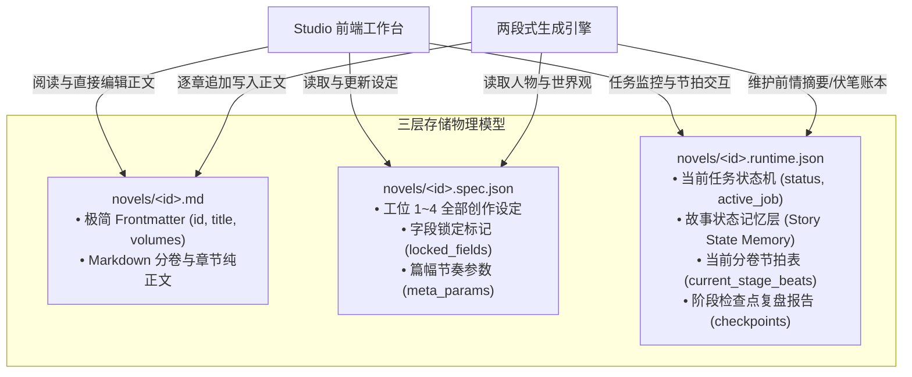
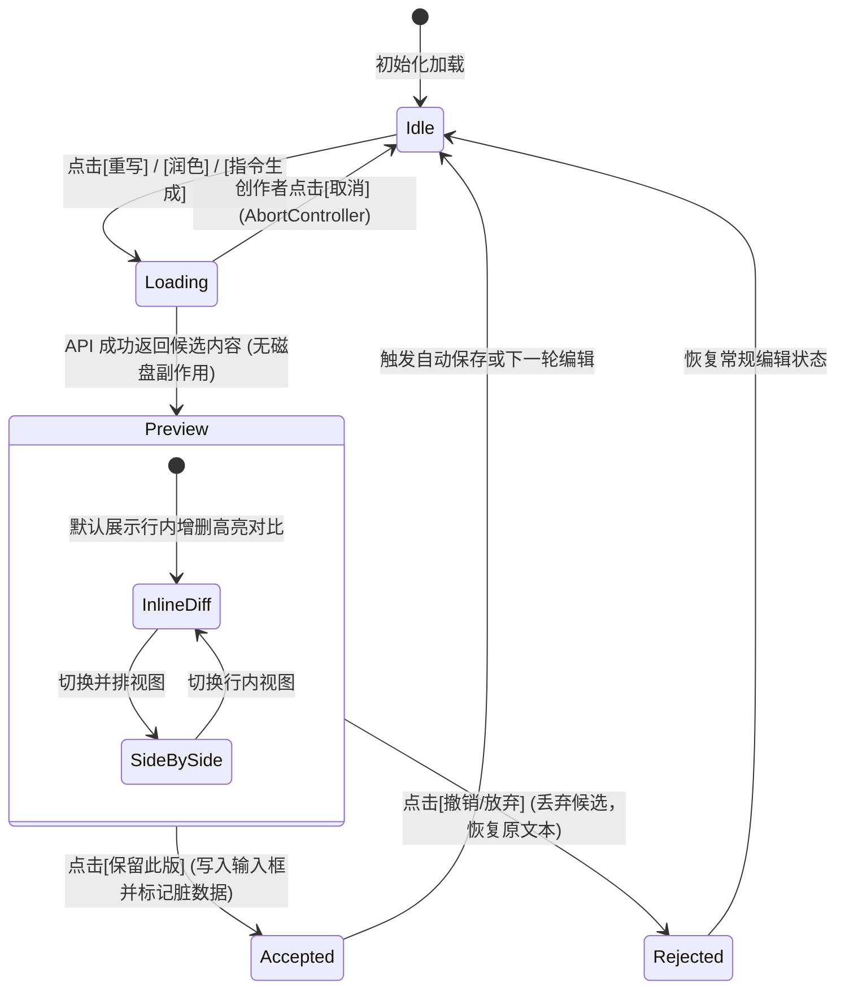
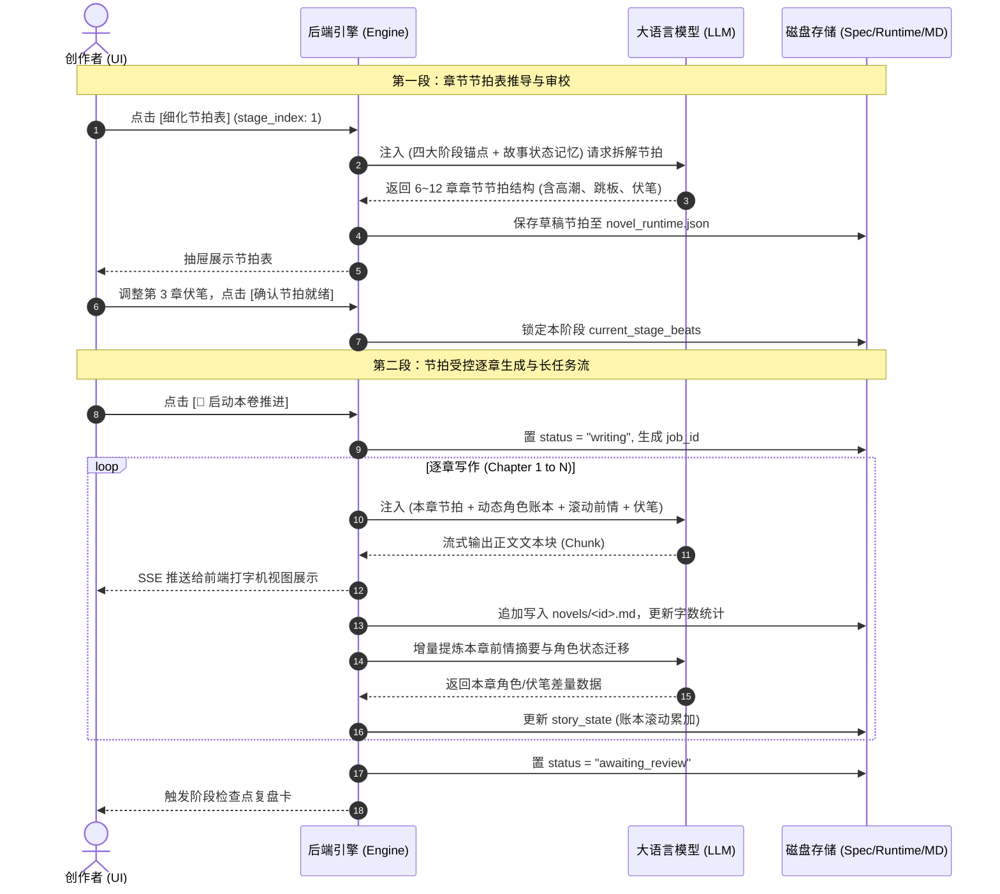

# 原创小说创作 Studio（Original Novel Studio）全流程架构与接口设计规范

> **版本**：v2.0 (Greenfield Architecture)  
> **状态**：正式规范（Approved Architecture）  
> **适用范围**：面向原创小说从零构思、设定推演、分卷节拍拆解、逐章受控生成至阶段复盘的全流程工作台。

---

## 目录

- [一、 系统定位与创作方法论全景](#一-系统定位与创作方法论全景)
  - [1.1 系统定位与设计哲学](#11-系统定位与设计哲学)
  - [1.2 「小说创作 6 步骤」与「Studio 4 大工位」映射模型](#12-小说创作-6-步骤与studio-4-大工位映射模型)
  - [1.3 三层物理存储架构（Three-Layer Storage）](#13-三层物理存储架构three-layer-storage)
- [二、 前端与 UI/UX 交互体系设计](#二-前端与-uiux-交互体系设计)
  - [2.1 整体布局与视觉规范（Modern Literary Atelier）](#21-整体布局与视觉规范modern-literary-atelier)
  - [2.2 4 大工位全流程交互流](#22-4-大工位全流程交互流)
  - [2.3 核心通用组件：`SpecField` 规范与状态机](#23-核心通用组件specfield-规范与状态机)
  - [2.4 章节节拍表（Beat List）抽屉与编辑交互](#24-章节节拍表beat-list抽屉与编辑交互)
  - [2.5 推进打字机视图与阶段检查点（Checkpoint）复盘卡](#25-推进打字机视图与阶段检查点checkpoint复盘卡)
- [三、 创作设定集与运行时数据模型（JSON Schema）](#三-创作设定集与运行时数据模型json-schema)
  - [3.1 设定集模型：`novel_spec.json`](#31-设定集模型novel_specjson)
  - [3.2 运行时状态与故事记忆模型：`novel_runtime.json`](#32-运行时状态与故事记忆模型novel_runtimejson)
  - [3.3 小说正文文档结构：`novels/<id>.md`](#33-小说正文文档结构novelsidmd)
- [四、 两段式受控生成引擎与长篇一致性状态机](#四-两段式受控生成引擎与长篇一致性状态机)
  - [4.1 阶段两段式生成工作流（Beat Planning → Execution）](#41-阶段两段式生成工作流beat-planning--execution)
  - [4.2 故事状态记忆层（Story State Memory）滚动更新算法](#42-故事状态记忆层story-state-memory滚动更新算法)
  - [4.3 阶段检查点偏差对齐与大纲回写闭环](#43-阶段检查点偏差对齐与大纲回写闭环)
- [五、 后端 RESTful 与 SSE 接口契约规范](#五-后端-restful-与-sse-接口契约规范)
  - [5.1 设定集存取：`GET / PUT /api/novel/original/spec`](#51-设定集存取get--put-apinoveloriginalspec)
  - [5.2 多工位链路推演：`POST /api/novel/original/deduce`](#52-多工位链路推演post-apinoveloriginaldeduce)
  - [5.3 字段级无副作用润色与重写：`POST /api/novel/original/refine-field`](#53-字段级无副作用润色与重写post-apinoveloriginalrefine-field)
  - [5.4 章节节拍表推导与保存：`POST /api/novel/original/stage/beats`](#54-章节节拍表推导与保存post-apinoveloriginalstagebeats)
  - [5.5 分卷推进任务控制：`POST /api/novel/original/stage/start` 及控制接口](#55-分卷推进任务控制post-apinoveloriginalstagestart-及控制接口)
  - [5.6 实时打字机推送流：`GET /api/novel/original/stage/stream/<job_id>`](#56-实时打字机推送流get-apinoveloriginalstagestreamjob_id)
  - [5.7 阶段检查点评审与大纲回写：`POST /api/novel/original/stage/checkpoint`](#57-阶段检查点评审与大纲回写post-apinoveloriginalstagecheckpoint)
- [六、 并发控制、容错恢复与工程实施路线](#六-并发控制容错恢复与工程实施路线)
  - [6.1 读写互斥锁与文件安全规范](#61-读写互斥锁与文件安全规范)
  - [6.2 长任务落盘与服务重启断点恢复机制](#62-长任务落盘与服务重启断点恢复机制)
  - [6.3 模块化实施里程碑与自检矩阵](#63-模块化实施里程碑与自检矩阵)

---

## 一、 系统定位与创作方法论全景

### 1.1 系统定位与设计哲学
本系统是一款面向严肃创作与网络文学并重的**全流程 AI 协同小说创作 Studio 工作台**。
系统摒弃“黑盒式点击生成全书”的粗糙模型，确立**“AI 深度推演、作者精细掌舵、结构锚点先行、长篇记忆护航”**的设计原则：

1. **题材中立与普适性**：
   无论是**古言宫斗、都市甜宠、现言酸涩、悬疑推理**，还是**赛博朋克、玄幻修真、无限流科幻**，系统底层的数据模型和提示词策略保持完全中立。不预设“打怪升级”或“反派打脸”的单一套路，核心冲突与情节动力由创作者填写的角色欲望、核心阻力与情感羁绊自主决定。
2. **渐进式自由度（高上限，低负担）**：
   创作者可以输入“一句话脑洞”一键推演全书设定，也可以手动精细雕琢每一处世界观规则与角色弧光；除书名、题材与主角设定为基础必填项外，**所有细节字段（如深层立意、副角色、特定阵营法则等）均为可选填项**。
3. **两段式受控创作**：
   彻底杜绝模型自发决定“何时高潮、何时完结”的不可控性，采用“**分卷锚点 → 细化章节节拍表（Beat List） → 逐章受控写作**”的工业化编剧工程模式。

---

### 1.2 「小说创作 6 步骤」与「Studio 4 大工位」映射模型

系统将专业故事学中的「小说创作 6 步骤」重构映射为 Studio 界面中的「4 大创作工位」，实现清晰的线性推进与任意跳转自由度：

| 创作 6 步骤 | Studio 工位归属 | 核心职责与产出物 | 自动化/协同模式 |
| :--- | :--- | :--- | :--- |
| **步骤 1：核心概念与构思** | **工位 01：核心创意与立意** | 一句话故事梗概 (Logline)、题材分类、核心卖点 (Hook)、读者预期情感曲线、深层立意 (Theme)、叙事基调与篇幅参数 | 一键推演初始骨架 / 字段级重写润色 |
| **步骤 2：角色设计与人物弧光** | **工位 02：世界观与核心人物** | 主角设定（外在目标 Want、内在驱动 Need、致命弱点/阴暗面、成长弧线）；关键关系人解耦（CP/羁绊、对抗者、导师、盟友） | 角色关系图谱化、人物口吻风格化定义 |
| **步骤 3：世界观构建与规则** | **工位 02：世界观与核心人物** | 核心自然/社会法则、超自然设定（若有）、生存/阶层矛盾、不可触犯的硬性禁忌 | 设定集一致性校验与上下文注入 |
| **步骤 4：主线冲突与终局设计** | **工位 03：主线矛盾与终局锚点** | 贯穿全书的核心阻力、**四大终局锚点**（终极愿景、最终危机、不可逆代价/灵魂抉择、终局情感余韵） | 锚定全书终局航标，防止后半程烂尾失控 |
| **步骤 5：大纲结构与阶段推进** | **工位 04：分卷规划与阶段推进** | 全书 3~5 阶段分卷大纲，每卷四大锚点（阶段诉求、核心阻力、情感引爆点、破局跳板） | 自动生成分卷骨架，提供分阶段推进中枢 |
| **步骤 6：细纲展开与场景撰写** | **工位 04 内嵌：两段式生成引擎** | **第一段**：分卷细化章节节拍表 (Beat List, 6~12 章)；<br>**第二段**：挂载故事状态记忆（Story State）逐章正文流式输出 | 人机协同审阅节拍表，打字机实时生成与阶段检查点偏差对齐 |

---

### 1.3 三层物理存储架构（Three-Layer Storage）

为避免设定数据、正文文本和运行时长任务状态互相污染导致数据丢失或版本冲突，系统采用清晰解耦的三层物理落盘体系：

```
novels/
├── <novel_id>.md              # [第一层] 纯净小说正文与轻量元数据 (Markdown)
├── <novel_id>.spec.json       # [第二层] 创作者设定集 (Creative Spec, 纯静态业务设定)
└── <novel_id>.runtime.json    # [第三层] 运行时状态机、长篇故事记忆与任务进度 (Runtime Engine)
```



- **第一层：`novels/<id>.md`**：保持为标准 Markdown 文件，用于 Studio 阅读器、分卷导出及手动编辑。Frontmatter 仅保留 `id`、`title`、`schema_version` 及分卷目录树引用，杜绝在其中塞入大量 YAML 设定。
- **第二层：`novels/<id>.spec.json`**：存放创作者决定的所有静态业务规格。支持字段锁定，推演和全量重写时绝对不覆盖带有 `"locked": true` 的字段；零运行时污染。
- **第三层：`novels/<id>.runtime.json`**：存放由生成引擎维护的动态状态，包括活跃任务 `job_id`、8 状态引擎枚举、滚动前情摘要、动态人物属性账本、伏笔台账及检查点分析报告。

---

## 二、 前端与 UI/UX 交互体系设计

### 2.1 整体布局与视觉规范（Modern Literary Atelier）
UI 继承并深化项目的“现代文学工作台（Modern Literary Atelier）”设计语言，采用高质感纸面温润底色与精确排版：
- **色彩体系**：纸白底色（`#F8F9FA`）、白卡面板（`#FFFFFF`）、深墨文字（`#111827`）、次级墨韵（`#4B5563`）、克莱因蓝主强调色（`#2563EB`）、琥珀警示色（`#D97706`）、松石绿完成色（`#059669`）、柔和边线（`#E5E7EB`）。
- **顶栏导航规范**：与全站整体结构统一，常驻品牌 Logo `NovelStudio`、模式导航 `[原创生成 (活跃态)]`、`[续写 · 同人]`、`[我的书架]`、`[全局设置]`；右侧展示当前作品标题及即时保存状态徽标（`● 已自动保存` / `⟳ 正在同步...`）。
- **左侧工作台步骤条（Stepper Sidebar）**：
  垂直展示 4 大工位（01 核心立意、02 世界人物、03 终局设计、04 分卷推进）。
  每个工位配有状态指示器（`待完善` / `部分填写` / `已完备` / `⚠️ 存在过期变更`），支持自由点击切换，无需强制线性步骤阻断。
- **右侧全局速览抽屉（Inspector Pane）**：
  提供可折叠的“创作常驻速查板”，浓缩显示一句话故事（Logline）、主角核心目标（Want/Need）、全书终局锚点及当前正在生成的章节状态，使作者在任何工位编辑时均能一览全局。

---

### 2.2 4 大工位全流程交互流

#### 工位 01：核心创意与故事立意
1. **题材与开局灵感（完全可选）**：
   - 题材预设（Chips 药丸标签组：言情甜宠、都市异能、古风权谋、悬疑推理、赛博修真、末日科幻等）。
   - 「开局灵感脑洞库」：提供“换一批”流式刷新，创作者可**自主点选**，亦可**点击“不使用脑洞，完全自主构思”清空选择**。
2. **核心字段矩阵**：
   - 书名（必填）、题材（必填）、一句话故事梗概 Logline（必填）。
   - 核心卖点 / Hook / 读者情绪爽点（可选）。
   - 目标读者情绪期待、深层立意 Theme、叙事基调与人称视角（均为可选）。
   - 篇幅节奏参数（预估总字数、预估总卷数、单卷章数目标、单章字数）。
3. **顶栏「⚡ 一键深度推演」行动点**：
   输入书名或基础概念后，点击触发 4 步链式推演，右侧工位卡片逐级通过骨架屏（Skeleton）过渡为生成内容。

#### 工位 02：世界观与核心角色（高灵活度解耦）
1. **世界观法则**：核心社会结构与生活图景、世界运转特殊规则、核心禁忌与不可逆法则。
2. **主角设定（必填）**：
   姓名、核心身份、外在欲望 (Want / 追求目标)、内在匮乏 (Need / 心理缺陷)、致命弱点、弧光轨迹。
3. **关键关系角色（完全可选，动态角色池）**：
   - 点击 `[+ 添加关键人物]`，创作者可自由增减。
   - 角色关系类型中立选择：`恋爱/CP对象`、`欢喜冤家`、`核心对抗者/竞争对手`、`挚友/盟友`、`导师/长辈`、`灰色第三方`。
   - 拒绝强制反派设定（例如在纯甜无虐治愈言情中，只需设置“阻碍恋情的现实生活障碍”，无需设置死敌）。

#### 工位 03：主线矛盾与终局设计（防止烂尾的定海神针）
1. **贯穿全书的核心阻力/矛盾**：如现实阶层差距、宗门宿命因果、不可调和的认知偏差。
2. **四大终局锚点（Final Anchors）**：
   - **终局愿景 (Climax Vision)**：全书高潮的最终解决场景。
   - **核心困境 (Core Dilemma)**：主角面临的最艰难抉择。
   - **不可逆代价 (Ultimate Cost)**：破局必须付出的牺牲或心态蜕变。
   - **终局情感余韵 (Resolution Tone)**：落幕时的读者余味（圆满甜蜜 / 壮烈沧桑 / 悬念未竟）。

#### 工位 04：分卷规划与两段式推进
1. **分卷阶段卡片列表**：默认规划 3~5 阶段（如 第 1 卷：破壳与相遇；第 2 卷：深化与危机；第 3 卷：决裂与死地；第 4 卷：归途与圆满）。
2. **阶段四大锚点**：阶段诉求、阶段核心阻力、阶段情感引爆点（阶段高潮）、破局跳板（下一卷钩子）。
3. **分卷两段式操作入口**：
   - `[📋 细化章节节拍表 (Beat List)]`：唤起抽屉展开本卷 6~12 章节拍列表。
   - `[🚀 开始本卷生成]`：基于节拍表启动后台长任务流水线。

---

### 2.3 核心通用组件：`SpecField` 规范与状态机

在整个 Studio 中，所有包含创作者文本输入的表单项**必须统一使用 `SpecField` 规范组件**进行渲染，杜绝在各工位重复书写各异的按钮逻辑。

#### 1. 结构与视觉布局
- **标签行**：字段标题 + `[必填]`（深蓝底浅字）/ `[可选]`（柔灰底暗字）徽标 + 字段编写指导说明气泡（Tooltip 说明“优秀样例是怎样的”）。
- **输入区域**：自动伸缩自适应高度的文本域（Textarea）。
- **字段统一工具条（Action Bar）**：
  在输入框聚焦或鼠标悬浮在卡片时优雅浮现，包含 5 个原子操作：
  - `[🔄 重写]`：基于全书已有上下文，换一个全新角度重新生成本字段内容。
  - `[✨ 润色]`：保留当前文本的核心骨干与人设，提升行文文采、张力与表达精度。
  - `[+ 指令]`：点击在下方滑出单行指令输入条，允许作者输入自定义引导（如：“加一点黑色幽默”、“把语气改得更冷酷疏离一些”）。
  - `[🔒 锁定]`：切换锁定状态。锁定后文本框只读，推演引擎与批量重写绝对不可覆盖此字段。
  - `[⏱ 历史]`：展开最近 5 次本地版本快照弹窗，支持一键恢复历史候选。

#### 2. `SpecField` 严格 5 态状态机



- **候选评审区（Review Panel）**：
  当处于 `Preview` 状态时，输入框下方即时展开候选对比抽屉，支持：
  - **行内高亮 Diff**：绿色背景代表新增字句，红色删除线代表移除字句。
  - **候选翻页**：当请求多条方案时，显示 `1/3` 分页器，提供 `[再来一个]` 刷新。
  - **单事务约束**：同一时刻一个字段仅允许处理一个待审候选，防止状态错乱。

---

### 2.4 章节节拍表（Beat List）抽屉与编辑交互

当作者进入某个阶段（分卷）并点击 `[📋 细化章节节拍表]` 时，右侧滑出全屏宽度 65% 的节拍表工作抽屉：

1. **节拍表列表项（Beat Item）**：
   - 章节序号与预估章名：如 `第 1 章：不速之客的拜访`。
   - 节拍功能标签（Badge）：`[引子/铺垫]`、`[阻力升级]`、`[💥 阶段高潮/引爆点]`、`[🔄 破局跳板/转折]`。
   - 核心剧情推进（1~2 句话）：精确描述本章主角要做的行动、核心冲突点与留给下一章的悬念。
   - 本章需注意的伏笔/人设细节。
2. **作者操作流**：
   - 支持拖拽排序调整章节推进节奏。
   - 支持手动新增章节、删除章节、编辑某章节拍。
   - 支持点击 `[✨ 重新编排节拍]`：AI 依据本阶段 4 大锚点重新进行节拍拆解。
   - 点击 `[确认节拍表并就绪生成]`：保存节拍表至 `novel_runtime.json`，进入生成就绪态。

---

### 2.5 推进打字机视图与阶段检查点（Checkpoint）复盘卡

#### 1. 推进打字机视图（Typewriter Runner View）
点击生成后，界面无缝切入沉浸式生成监控视图：
- **阶段进度条**：展示“正在生成 第 2 卷 第 3 章（全卷共 8 章）- 进度 37.5%”。
- **长篇记忆状态实时显示**：
  - 当前场景主要人物与当前情绪值。
  - 本章活跃伏笔追踪（如：“伏笔：主角袖中的断剑被师尊察觉”）。
- **流式打字机正文展示**：
  通过 SSE 协议实时向只读阅读面板流式推送 Markdown 文本，伴随平滑光标跳动，作者可随时点击 `[⏸ 暂停任务]` 或 `[⏹ 终止生成]`。

#### 2. 阶段检查点（Checkpoint）复盘卡
当某一卷的所有章节按节拍全部生成完毕后，引擎自动进入**检查点评审态（Awaiting Review）**，并在界面中央呈现复盘卡：
- **锚点达成度对比**：
  - 原设阶段高潮：“两人在暴雨夜挑明身世，协议决裂” $\longleftrightarrow$ 正文实际进展：“挑明身世达成，但男主负伤推迟了决裂，增加了女主愧疚心理”。
- **偏离度预警**：
  - 若模型在生成过程中产生未预设的情感升温或阵营叛变，卡片明确标出“⚠️ 产生大纲外剧情偏离”。
- **下一阶段自适应调整建议（AI 建议）**：
  - AI 给出修订方案：“由于男主负伤未决裂，建议将第 3 卷第 1 章锚点由‘反目追杀’调整为‘带伤同行中的相互猜疑’”。
- **作者动作**：
  - `[✅ 一键采纳建议并回写下一卷大纲]`：自动更新 `novel_spec.json` 中的后续分卷设定。
  - `[✏️ 手动微调后进入下一卷]`。
  - `[📖 前往 Studio 阅读器审阅精修正文]`。

---

## 三、 创作设定集与运行时数据模型（JSON Schema）

### 3.1 设定集模型：`novel_spec.json`

此文件为创作者唯一的静态业务设定真理来源（Single Source of Truth），绝无任务进度和前情摘要等运行时脏数据：

```json
{
  "$schema": "https://json-schema.org/draft/2020-12/schema",
  "title": "NovelCreativeSpec",
  "type": "object",
  "required": ["schema_version", "meta", "ideation", "protagonist", "ending", "stages"],
  "properties": {
    "schema_version": { "type": "string", "enum": ["2.0.0"] },
    "locked_fields": {
      "type": "array",
      "description": "已被作者锁定、禁止推演或自动覆盖的 field_path 列表",
      "items": { "type": "string" }
    },
    "meta": {
      "type": "object",
      "required": ["title", "genre"],
      "properties": {
        "title": { "type": "string", "minLength": 1, "maxLength": 60 },
        "genre": { "type": "string", "minLength": 1, "maxLength": 30 },
        "selected_trope": { "type": ["string", "null"], "description": "所选灵感脑洞，可为 null" },
        "target_total_words": { "type": "integer", "default": 300000 },
        "target_stages_count": { "type": "integer", "default": 4 },
        "target_words_per_chapter": { "type": "integer", "default": 2500 }
      }
    },
    "ideation": {
      "type": "object",
      "required": ["logline"],
      "properties": {
        "logline": { "type": "string", "description": "一句话故事梗概 (必填)" },
        "hook": { "type": "string", "description": "核心卖点/引人入胜的开局悬念 (可选)" },
        "reader_expectation": { "type": "string", "description": "目标读者核心情绪体验 (可选)" },
        "theme": { "type": "string", "description": "深层立意/思想表达 (可选)" },
        "tone": { "type": "string", "description": "叙事基调与视角 (如：第三人称限制视角、幽默诙谐/冷硬写实) (可选)" }
      }
    },
    "worldview": {
      "type": "object",
      "properties": {
        "background": { "type": "string", "description": "核心时代背景与社会生活图谱 (可选)" },
        "special_rules": { "type": "string", "description": "核心自然法则/超自然设定/游戏规则 (可选)" },
        "taboos": { "type": "string", "description": "不可触犯的硬性禁忌与代价 (可选)" }
      }
    },
    "protagonist": {
      "type": "object",
      "required": ["name", "role", "want", "need"],
      "properties": {
        "id": { "type": "string", "default": "char_protagonist" },
        "name": { "type": "string", "minLength": 1 },
        "role": { "type": "string", "description": "核心身份与社会地位" },
        "want": { "type": "string", "description": "外在明确追求的目标" },
        "need": { "type": "string", "description": "内心缺失的真正觉醒点/深层心理需求" },
        "flaw": { "type": "string", "description": "性格盲区/致命弱点" },
        "arc": { "type": "string", "description": "全书人物成长轨迹" }
      }
    },
    "characters": {
      "type": "array",
      "description": "关键关系人物列表 (完全解耦，可选)",
      "items": {
        "type": "object",
        "required": ["id", "name", "relation_type"],
        "properties": {
          "id": { "type": "string" },
          "name": { "type": "string" },
          "relation_type": {
            "type": "string",
            "enum": ["cp_love", "rival_antagonist", "mentor", "ally_friend", "neutral_third"]
          },
          "role_desc": { "type": "string" },
          "bond_or_conflict": { "type": "string", "description": "与主角的羁绊纽带或核心冲突点" }
        }
      }
    },
    "ending": {
      "type": "object",
      "required": ["climax_vision", "core_dilemma", "ultimate_cost", "resolution_tone"],
      "properties": {
        "climax_vision": { "type": "string", "description": "终局决胜场景愿景" },
        "core_dilemma": { "type": "string", "description": "终局面临的核心矛盾抉择" },
        "ultimate_cost": { "type": "string", "description": "终局付出的不可逆代价或心理转变" },
        "resolution_tone": { "type": "string", "description": "落幕余韵情感基调" }
      }
    },
    "stages": {
      "type": "array",
      "description": "全书分卷阶段列表 (通常 3~5 阶段)",
      "items": {
        "type": "object",
        "required": ["stage_index", "title", "anchors"],
        "properties": {
          "stage_index": { "type": "integer" },
          "title": { "type": "string" },
          "expected_chapters": { "type": "integer", "default": 8 },
          "anchors": {
            "type": "object",
            "required": ["stage_goal", "main_obstacle", "climax_hook", "transition_springboard"],
            "properties": {
              "stage_goal": { "type": "string", "description": "本卷主角的核心诉求/目标" },
              "main_obstacle": { "type": "string", "description": "本卷最主要的阻力与冲突源" },
              "climax_hook": { "type": "string", "description": "本卷的高潮爆发点/情感引爆点" },
              "transition_springboard": { "type": "string", "description": "本卷结尾破局跳板与引出下卷的悬念" }
            }
          }
        }
      }
    }
  }
}
```

---

### 3.2 运行时状态与故事记忆模型：`novel_runtime.json`

此文件完全由后台任务与生成引擎维护，负责长任务进度、可恢复性与长篇故事记忆：

```json
{
  "$schema": "https://json-schema.org/draft/2020-12/schema",
  "title": "NovelRuntimeEngineState",
  "type": "object",
  "required": ["schema_version", "status", "current_stage_index", "story_state"],
  "properties": {
    "schema_version": { "type": "string", "enum": ["2.0.0"] },
    "status": {
      "type": "string",
      "enum": [
        "idle",             // 闲置状态，等待创作者指令
        "planning_beats",   // 正在拆解细分章节节拍表
        "writing",          // 正在逐章生成正文 (SSE 活跃)
        "paused",           // 任务被作者主动暂停
        "awaiting_review",  // 当前阶段生成完毕，正在检查点等待复盘
        "completed",        // 全书所有阶段均已顺利完成
        "failed"            // 生成过程出现异常阻断
      ]
    },
    "active_job": {
      "type": ["object", "null"],
      "properties": {
        "job_id": { "type": "string" },
        "stage_index": { "type": "integer" },
        "chapter_index": { "type": "integer" },
        "total_stage_chapters": { "type": "integer" },
        "started_at": { "type": "string", "format": "date-time" },
        "last_heartbeat": { "type": "string", "format": "date-time" }
      }
    },
    "current_stage_beats": {
      "type": "array",
      "description": "当前阶段已确认的章节节拍表 (Beat List)",
      "items": {
        "type": "object",
        "required": ["chapter_offset", "title", "beat_type", "summary"],
        "properties": {
          "chapter_offset": { "type": "integer" },
          "global_chapter_idx": { "type": "integer" },
          "title": { "type": "string" },
          "beat_type": { "type": "string", "enum": ["setup", "escalation", "climax", "transition"] },
          "summary": { "type": "string" },
          "planted_clues": { "type": "array", "items": { "type": "string" } },
          "is_generated": { "type": "boolean", "default": false }
        }
      }
    },
    "story_state": {
      "type": "object",
      "description": "长篇一致性故事记忆层 (Story State Memory)",
      "required": ["rolling_summary", "characters_ledger", "clues_ledger"],
      "properties": {
        "rolling_summary": {
          "type": "string",
          "description": "前情摘要滚动压缩包 (控制在 800~1500 字，按卷累加提炼)"
        },
        "characters_ledger": {
          "type": "object",
          "description": "动态角色属性账本 (记录当前位置、心境变化、实力等级、最新关系)",
          "additionalProperties": {
            "type": "object",
            "properties": {
              "current_status": { "type": "string" },
              "relationship_with_protagonist": { "type": "string" },
              "inventory_or_secrets": { "type": "array", "items": { "type": "string" } }
            }
          }
        },
        "clues_ledger": {
          "type": "array",
          "description": "伏笔追踪明细账本",
          "items": {
            "type": "object",
            "properties": {
              "clue_id": { "type": "string" },
              "content": { "type": "string" },
              "planted_at_chapter": { "type": "integer" },
              "status": { "type": "string", "enum": ["planted", "revealed", "abandoned"] },
              "resolved_at_chapter": { "type": ["integer", "null"] }
            }
          }
        }
      }
    },
    "checkpoints": {
      "type": "array",
      "description": "各阶段检查点偏差分析历史记录",
      "items": {
        "type": "object",
        "properties": {
          "stage_index": { "type": "integer" },
          "completed_at": { "type": "string", "format": "date-time" },
          "deviation_report": { "type": "string" },
          "applied_modifications": { "type": "string" }
        }
      }
    }
  }
}
```

---

### 3.3 小说正文文档结构：`novels/<id>.md`

正文 Markdown 文件保持高度极简纯净，严禁污染业务配置：

```markdown
---
id: "cyber_taoist_001"
title: "赛博道祖"
schema_version: "2.0.0"
spec_ref: "cyber_taoist_001.spec.json"
runtime_ref: "cyber_taoist_001.runtime.json"
current_volume: 1
total_words: 24580
created_at: "2026-11-13T22:30:00Z"
updated_at: "2026-11-13T22:45:12Z"
---

# 第一卷：底层机魂与铁锈符箓

## 第 1 章：机械义眼的杂讯

深秋的九龙霓虹雨夜，水洼里倒映着巨型全息道尊像的猩红投影...

## 第 2 章：第三型神经飞剑

……
```

---

## 四、 两段式受控生成引擎与长篇一致性状态机

### 4.1 阶段两段式生成工作流（Beat Planning → Execution）

彻底解决传统大模型“一次性生成整卷导致脱缰烂尾”的顽疾，引擎遵循以下闭环：



---

### 4.2 故事状态记忆层（Story State Memory）滚动更新算法

长篇跨卷写作最容易出现“战力崩坏、角色遗忘、伏笔断头”。引擎在每一章落盘后触发一次**微型增量抽取（Micro-Incremental Extractor）**：

1. **增量输入上下文**：
   - 上一轮滚动摘要（800 字以内）
   - 本章正文（2000~3000 字）
   - 当前活跃伏笔列表
2. **LLM 抽取指令与契约输出**：
   - 输出三元组更新：
     ```json
     {
       "summary_delta": "本章男主在黑市以断剑换取了重构芯片，女主暗中尾随察觉其身份。",
       "character_updates": [
         {
           "name": "男主角",
           "status_change": "左臂神经接驳烧损，对女主产生戒备心"
         }
       ],
       "clue_triggers": [
         {
           "clue_id": "clue_broken_sword",
           "status": "revealed",
           "note": "女主已辨认出剑柄花纹"
         }
       ]
     }
     ```
3. **滚动合并策略**：
   - `rolling_summary` 采用滑动窗口累加；当累积字数超过 1500 字时，自动触发一次高阶精简提炼（Rollup Compression），保持上下文紧凑稳定。
   - `characters_ledger` 就地根据角色 ID 更新属性覆盖。
   - `clues_ledger` 实时标记伏笔状态（`planted` $\rightarrow$ `revealed`），并在后续提示词中移除已完结的伏笔，保持上下文干净。

---

### 4.3 阶段检查点偏差对齐与大纲回写闭环

在一卷生成结束后，大模型汇总本卷全貌，与 `novel_spec.json` 中预设的阶段四大锚点做 Diff 评估：
1. **偏差度度量指标**：
   - 核心目标达成度（百分比）
   - 角色弧光走向一致性（是否出现性格崩塌）
   - 新增突发情节对全书终局的影响评估
2. **自适应大纲回写（Spec Write-Back）**：
   - 若出现正向剧情延展，AI 自动重构后续各卷的 `anchors`（例如将第 3 卷的破局方式从“正面硬闯”自适应变更为“智取渗透”）。
   - 创作者在前端复盘卡中点击 `[采纳修订]`，后端即刻通过 `PUT /api/novel/original/spec` 将修订内容正式回写至 `novel_spec.json`，确保后续章节的推演始终基于最新的现实剧情。

---

## 五、 后端 RESTful 与 SSE 接口契约规范

### 5.1 设定集存取：`GET / PUT /api/novel/original/spec`

#### 1. 获取小说设定集
- **请求方式**：`GET /api/novel/original/spec?novel_id=<id>`
- **成功响应 (200 OK)**：
  ```json
  {
    "code": 200,
    "msg": "success",
    "data": {
      "novel_id": "cyber_taoist_001",
      "spec": { /* 完整的 novel_spec.json 内容 */ }
    }
  }
  ```

#### 2. 保存/更新小说设定集
- **请求方式**：`PUT /api/novel/original/spec`
- **请求体 (JSON)**：
  ```json
  {
    "novel_id": "cyber_taoist_001",
    "spec": { /* 需保存更新的 novel_spec.json 全量或增量数据 */ }
  }
  ```
- **核心约束**：
  - 必须对指定小说加文件互斥锁 `with lock_novel(novel_id):`。
  - 后端执行严格的 JSON Schema 校验，校验不通过返回 `400 Bad Request`。
- **成功响应 (200 OK)**：
  ```json
  { "code": 200, "msg": "spec saved successfully" }
  ```

---

### 5.2 多工位链路推演：`POST /api/novel/original/deduce`

一键链式推演全书初始骨架。

- **请求方式**：`POST /api/novel/original/deduce`
- **请求体 (JSON)**：
  ```json
  {
    "title": "微醺心跳定律",
    "genre": "都市言情·甜宠",
    "selected_trope": "合租屋里的猫咪与合约情侣",
    "user_pitch": "傲娇调酒师与失眠插画师的合租日常，契约恋爱成真",
    "meta_params": {
      "target_total_words": 150000,
      "target_stages_count": 4
    },
    "locked_fields": ["protagonist.name", "ideation.logline"]
  }
  ```
- **推演链路控制流**：
  - 串联 4 阶段提示词链路：`Step 1 创意立意` $\rightarrow$ `Step 2 世界与人物` $\rightarrow$ `Step 3 终局设计` $\rightarrow$ `Step 4 分卷规划`。
  - **锁定保护**：严格保留 `locked_fields` 中指定字段的原有值，绝不覆盖。
- **成功响应 (200 OK)**：
  返回符合 `novel_spec.json` 结构的完整推演数据。

---

### 5.3 字段级无副作用润色与重写：`POST /api/novel/original/refine-field`

单字段 AI 精修中枢。**核心铁律：本接口纯内存无状态，绝不修改磁盘上的任何 spec 或 markdown 文件**，仅生成并返回候选方案，由作者在前端点击“保留此版”后才提交保存。

- **请求方式**：`POST /api/novel/original/refine-field`
- **请求体 (JSON)**：
  ```json
  {
    "novel_id": "cyber_taoist_001",
    "field_path": "protagonist.flaw",
    "mode": "rewrite",            // "rewrite" (重写) | "polish" (润色)
    "current_value": "过于自负，不相信队友",
    "user_hint": "加入一点童年遭遇导致的偏执和创伤反应",
    "spec_context": { /* 完整的 spec 快照，为 LLM 提供全景上下文 */ },
    "candidates_count": 1
  }
  ```
- **成功响应 (200 OK)**：
  ```json
  {
    "code": 200,
    "msg": "success",
    "data": {
      "field_path": "protagonist.flaw",
      "mode": "rewrite",
      "candidates": [
        "极度缺乏安全感引发的偏执防御；童年因信任孤儿院同伴导致义肢被剥夺，从此对任何形式的团队协作怀有病态怀疑，宁可单兵作战至义体过载。"
      ]
    }
  }
  ```

---

### 5.4 章节节拍表推导与保存：`POST /api/novel/original/stage/beats`

- **请求方式**：`POST /api/novel/original/stage/beats`
- **请求体 (JSON)**：
  ```json
  {
    "novel_id": "cyber_taoist_001",
    "stage_index": 1,
    "action": "generate",   // "generate" (全新推演) | "save" (作者手动编辑后保存)
    "beats": [ /* 若 action 为 save 时传入修改后的节拍数组 */ ]
  }
  ```
- **成功响应 (200 OK)**：
  ```json
  {
    "code": 200,
    "msg": "beats updated",
    "data": {
      "stage_index": 1,
      "beats": [
        {
          "chapter_offset": 1,
          "global_chapter_idx": 1,
          "title": "第 1 章：机械义眼的杂讯",
          "beat_type": "setup",
          "summary": "主角在九龙城寨修理走私义眼，遭遇神秘赛博教徒临死前托付断剑芯片。",
          "planted_clues": ["断剑芯片内的加密铭文", "义眼残留的红光残影"]
        }
      ]
    }
  }
  ```

---

### 5.5 分卷推进任务控制：`POST /api/novel/original/stage/start` 及控制接口

#### 1. 启动分卷推进长任务
- **请求方式**：`POST /api/novel/original/stage/start`
- **请求体 (JSON)**：
  ```json
  {
    "novel_id": "cyber_taoist_001",
    "stage_index": 1
  }
  ```
- **核心逻辑**：
  - 校验当前小说是否已有正在运行的 job，若有且未死锁返回 `409 Conflict`。
  - 生成全局唯一 `job_id = "job_<uuid>"`，将 `novel_runtime.json` 状态置为 `"writing"` 并落盘。
  - 启动独立后台守护线程执行受控两段式生成。
- **成功响应 (202 Accepted)**：
  ```json
  {
    "code": 202,
    "msg": "stage generation started",
    "data": {
      "job_id": "job_9b8d4e97_stage1",
      "stream_url": "/api/novel/original/stage/stream/job_9b8d4e97_stage1"
    }
  }
  ```

#### 2. 任务状态控制（暂停 / 恢复 / 取消）
- **请求方式**：`POST /api/novel/original/stage/control`
- **请求体 (JSON)**：
  ```json
  {
    "job_id": "job_9b8d4e97_stage1",
    "action": "pause" // "pause" | "resume" | "cancel"
  }
  ```
- **成功响应 (200 OK)**：
  ```json
  { "code": 200, "msg": "job status updated to paused" }
  ```

#### 3. 轮询任务状态（服务重启与断线恢复）
- **请求方式**：`GET /api/novel/original/stage/status/<job_id>`
- **成功响应 (200 OK)**：
  返回任务当前阶段、章节进度、当前已生成字数、状态枚举（`writing` / `paused` / `awaiting_review` 等）。

---

### 5.6 实时打字机推送流：`GET /api/novel/original/stage/stream/<job_id>`

前端通过标准 HTML5 `EventSource` 连接本接口，实时监听生成打字机事件：

- **协议规范**：`Content-Type: text/event-stream; charset=utf-8`，禁用响应缓冲。
- **事件类型矩阵**：

| SSE Event | 载荷数据结构示例 | 说明 |
| :--- | :--- | :--- |
| `event: init` | `{"job_id":"...","stage_index":1,"total_chapters":8}` | 连接成功握手，返回任务元数据 |
| `event: chapter_start` | `{"chapter_idx":1,"title":"第 1 章：机械义眼的杂讯"}` | 新章节开始生成 |
| `event: token` | `{"text":"深秋的九龙霓虹雨夜..."}` | 实时打字机正文片段，逐字流式推送 |
| `event: chapter_end` | `{"chapter_idx":1,"words":2850,"summary":"..."}` | 单章生成完毕，正文已原子写盘 |
| `event: story_state_sync`| `{"characters_ledger":{...},"clues_ledger":[...]}` | 本章角色账本与伏笔更新广播 |
| `event: stage_complete` | `{"stage_index":1,"checkpoint_ready":true}` | 本卷所有章节全部完成，进入复盘卡 |
| `event: error` | `{"code":500,"error":"LLM provider timeout"}` | 异常中断事件，指示客户端展示重试 |

---

### 5.7 阶段检查点评审与大纲回写：`POST /api/novel/original/stage/checkpoint`

- **请求方式**：`POST /api/novel/original/stage/checkpoint`
- **请求体 (JSON)**：
  ```json
  {
    "novel_id": "cyber_taoist_001",
    "stage_index": 1,
    "action": "accept_and_writeback", // "accept_and_writeback" | "dismiss"
    "spec_modifications": {
      "stages": [
        /* 采纳修订后的后续各卷 stage anchors 补丁数据 */
      ]
    }
  }
  ```
- **成功响应 (200 OK)**：
  ```json
  {
    "code": 200,
    "msg": "checkpoint applied and spec updated",
    "data": {
      "next_stage_index": 2,
      "status": "idle"
    }
  }
  ```

---

## 六、 并发控制、容错恢复与工程实施路线

### 6.1 读写互斥锁与文件安全规范

1. **统一互斥锁（`lock_novel`）**：
   所有涉及以下操作的后端逻辑，必须强制使用 `with lock_novel(novel_id):` 作用域：
   - 写入 `novels/<id>.md`（单章落盘、全本合并）。
   - 写入 `novels/<id>.spec.json`（设定自动保存、大纲回写）。
   - 写入 `novels/<id>.runtime.json`（任务状态流转、账本更新）。
2. **只读幂等保障**：
   所有 `GET` 请求（如获取 spec、查询任务状态）均为严格只读操作，严禁在 GET 请求中顺带执行修补写盘逻辑。
3. **Studio 正在生成时的写入冲突保护**：
   当后台任务处于 `"writing"` 状态时，前端 Studio 正文编辑器对当前正在生成的卷开启编辑保护；若用户尝试保存外部手动修改，接口返回 `409 Conflict`（“当前卷正在由 AI 生成，请等待完成或暂停任务后再编辑”），杜绝并发写入丢字覆盖。

---

### 6.2 长任务落盘与服务重启断点恢复机制

1. **心跳自愈机制**：
   后台生成线程每 5 秒更新一次 `novel_runtime.json` 中的 `active_job.last_heartbeat`。
   若 Flask 服务因断电或重启导致进程退出，服务重启时检测到任务仍处于 `"writing"` 且心跳超时超过 60 秒，自动将任务置为 `"failed"` 或 `"paused"`，并记录已安全落盘的最大章节号。
2. **断点无损续跑（Idempotent Resume）**：
   作者刷新页面后，前端检测到任务处于中断状态，提示 `[▶ 从第 N+1 章继续推进]`。
   引擎读取 `novels/<id>.md` 已有章节与 `story_state` 记忆最新快照，无缝初始化下一章的生成任务，绝不重复生成已有章节。

---

### 6.3 模块化实施里程碑与自检矩阵

本项目从 0 开始构建，划分为 4 个高度解耦的实施阶段（Milestones）：


| 里程碑 | 核心产出与模块 | 交付检验标准与自动化测试 |
| :--- | :--- | :--- |
| **M1: 存储与基石** | 三层文件读写机制、JSON Schema 校验器、`spec` 存取 REST 接口、无副作用字段级精修接口 `refine-field` | Pytest 单元测试覆盖全矩阵；验证 `refine-field` 的 0 磁盘写盘安全性；验证并发互斥锁 `lock_novel` |
| **M2: 两段式引擎** | 4 步链路深度推演逻辑、章节节拍表（Beat List）推导算法、增量故事状态抽取器（前情摘要+账本更新） | Mock LLM 驱动多卷生成流水线；验证伏笔自动关闭；验证前情摘要超过阈值自动压缩；验证断点重启恢复 |
| **M3: 前端 Studio** | 4 大工位界面重构、`SpecField` 核心组件实现（5 态状态机、Diff 对比抽屉、+指令交互）、节拍表抽屉 | 语法校验 `node --check`；静态 DOM 关联检查；无裸写事件绑定；完整交互走通 |
| **M4: 闭环与联调** | SSE 实时打字机推送通道、任务控制接口（暂停/恢复）、阶段检查点多维复盘卡、大纲自动回写闭环 | 全链路 E2E 浏览器测试；验证高并发打字机稳定性；验证检查点采纳后自动回写 `spec.json` |

---
*文档归档路径：`docs/original_novel_studio_design.md`*
